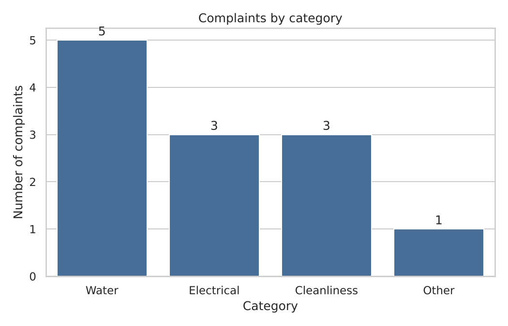
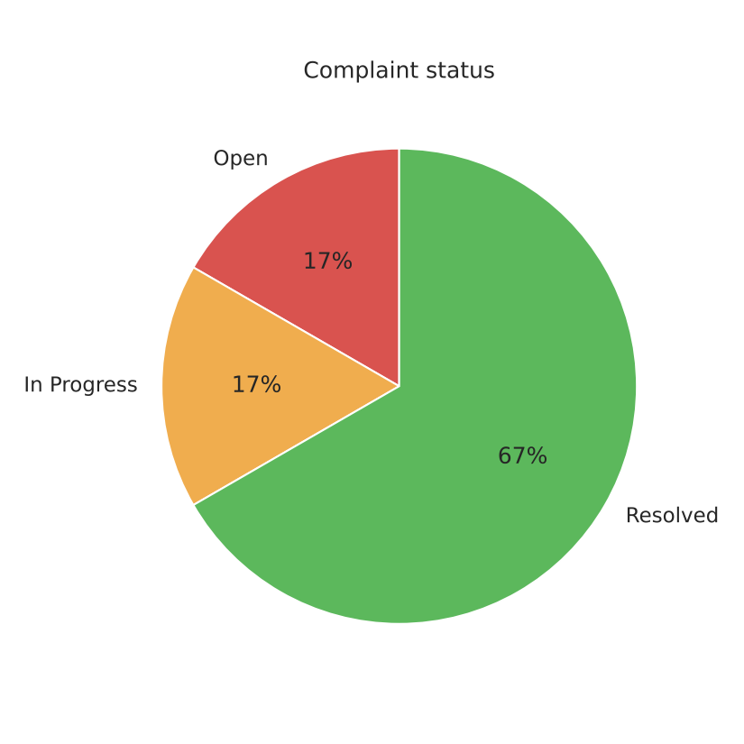
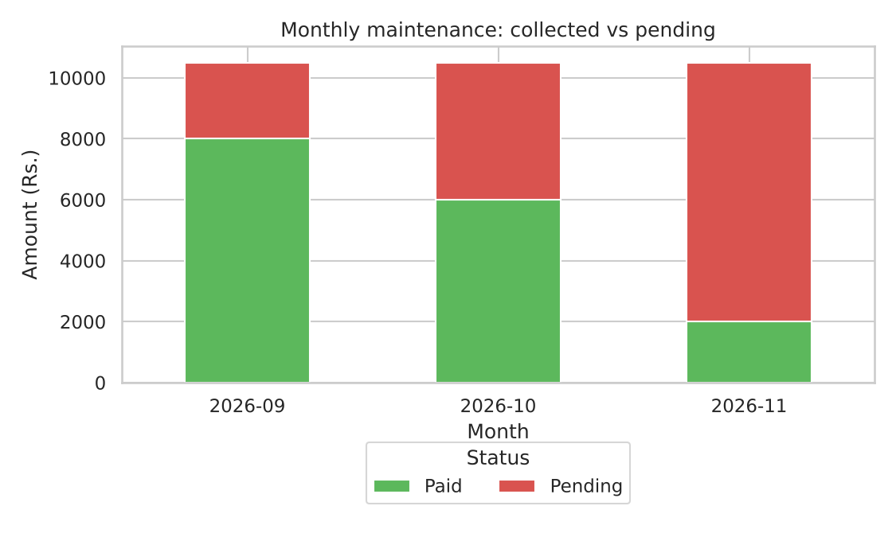
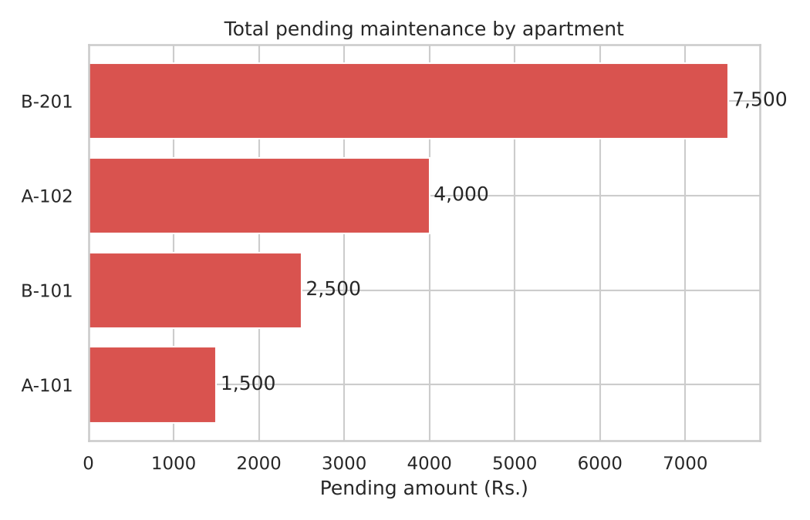
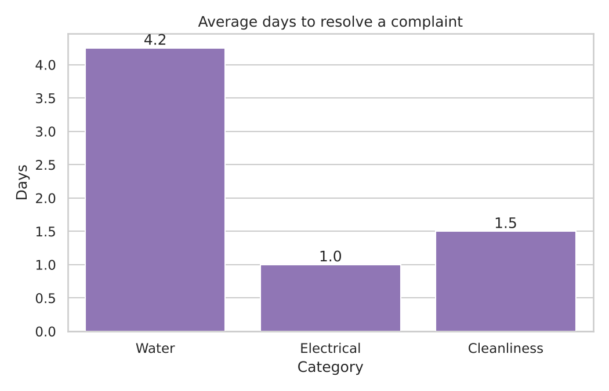
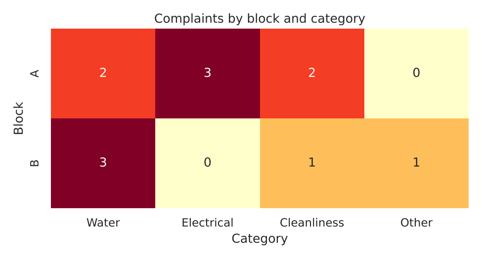
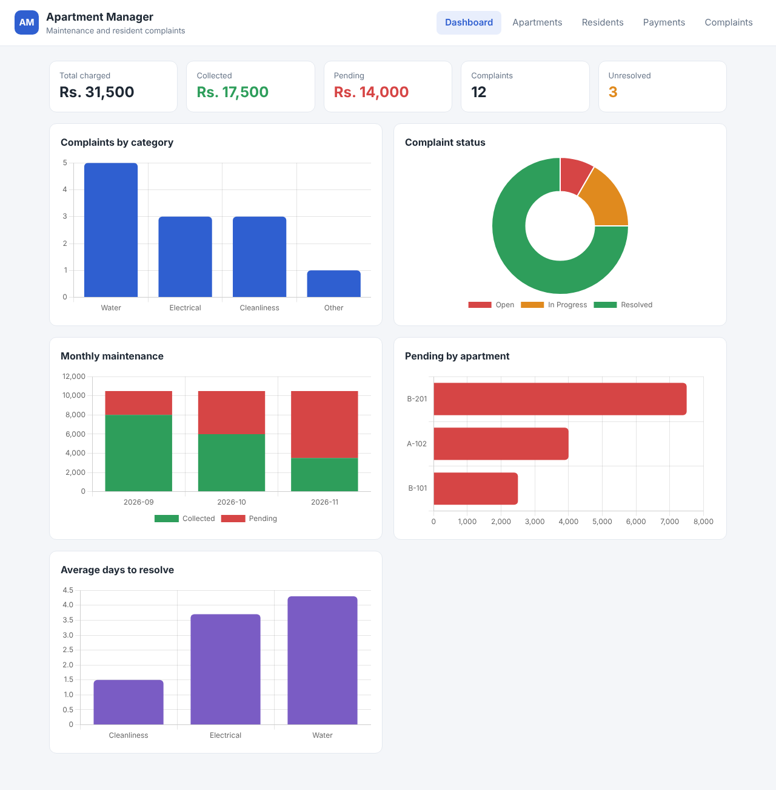
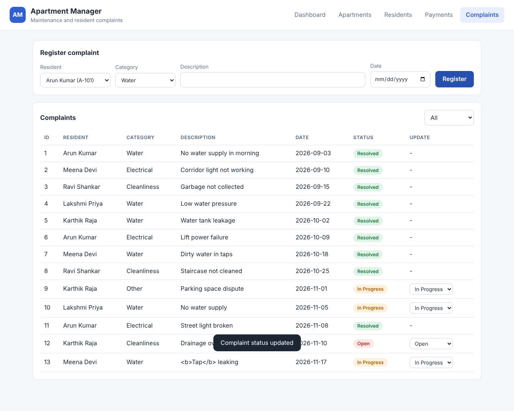

# Apartment Maintenance and Resident Complaint Management System

A Java + SQL + Python project that manages apartment and resident records, tracks monthly maintenance payments, handles resident complaints, and analyses facility problems with charts.

**Student:** _<your name>_ | **Register No:** _<your number>_ | **Dept:** B.Tech IT, Velalar College of Engineering and Technology
**Courses covered:** Java Programming (25ITT32), Software Engineering (25ITT33), Foundations of Data Science (25ITC31)

## Problem statement
Manual handling of resident details, maintenance fees and complaints (water, electrical, cleanliness, other) causes delayed resolution, difficulty tracking payments, and no view of recurring problems. This system stores everything in a database, enforces rules in Java, and uses Python to find patterns.

## Features
- Add and view apartments (block, type, occupancy) and residents (ID, name, apartment, contact)
- Record monthly maintenance charges and mark them Paid or Pending
- Register complaints with category, description and date
- Track status: Open -> In Progress -> Resolved
- Reports: pending payments, category-wise complaints, status summary, average resolution time
- Web app (browser): dashboard with charts, forms, tables, filters
- Python: data retrieval, cleaning, and 7 charts

## Technologies
| Part | Technology |
|---|---|
| Application | Java 11+ (OOP, JDBC, collections, streams, exception handling) |
| Web app | Java built-in HTTP server (REST-style JSON API), HTML, CSS, JavaScript, Chart.js |
| Database | SQLite (no server needed) |
| Analysis | Python 3.9+, pandas, Matplotlib, Seaborn |
| Diagrams | Mermaid |

## Project structure
```
apartment-management-system/
├── README.md
├── docs/
│   ├── SRS.md                  Software Requirements Specification
│   ├── database_design.md      ER diagram, relational model, normalization
│   ├── test_plan.md            Testing techniques and 24 test cases
│   └── diagrams/               use case, class, architecture, ER (PNG + Mermaid source)
├── java/
│   ├── src/                    Main, WebServer, ManagementService, models, TestRunner
│   ├── lib/sqlite-jdbc.jar     database driver
│   └── sample_io/              sample input and output of a menu session
├── index.html                  redirects to web/ (used by GitHub Pages)
├── web/                        index.html, style.css, app.js, demo.js, chart.umd.js (browser UI)
├── sql/                        schema.sql, sample_data.sql, queries.sql
├── python/                     analysis.py, setup_db.py, requirements.txt
└── outputs/                    charts, cleaned CSV files, test results
```

## How to run

Open a terminal **in the project root folder** (the one containing `sql/` and `java/`).

### 1. Database setup
The Java program creates `apartment.db` automatically from `sql/schema.sql` and `sql/sample_data.sql` on first run. To create it manually instead:
```bash
sqlite3 apartment.db < sql/schema.sql
sqlite3 apartment.db < sql/sample_data.sql
sqlite3 apartment.db < sql/queries.sql      # runs the report queries
```
(or `python python/setup_db.py` if you do not have the sqlite3 tool)

### 2a. Run the WEB APP (opens in the browser)
Linux / macOS:
```bash
javac -d java/out java/src/*.java
java -cp "java/out:java/lib/sqlite-jdbc.jar" WebServer
```
Windows (note the `;`):
```bat
javac -d java\out java\src\*.java
java -cp "java\out;java\lib\sqlite-jdbc.jar" WebServer
```
Then open **http://localhost:8080** in a browser. Press `Ctrl+C` in the terminal to stop. To use another port add `-Dport=9000` before `WebServer`.

The web app has a dashboard with live charts, and pages for apartments, residents, payments and complaints (add records, mark payments paid, update complaint status).

### 2b. Run the console version
Linux / macOS:
```bash
javac -d java/out java/src/*.java
java -cp "java/out:java/lib/sqlite-jdbc.jar" Main
```
Windows (note the `;`):
```bat
javac -d java\out java\src\*.java
java -cp "java\out;java\lib\sqlite-jdbc.jar" Main
```
To replay the sample session: add `< java/sample_io/sample_input.txt` to the last command.

### 3. Run the tests
```bash
java -cp "java/out:java/lib/sqlite-jdbc.jar" -Ddb.path=test_apartment.db TestRunner
```
Expected: `Result: 24 passed, 0 failed`.

### 4. Python analysis and charts
```bash
pip install -r python/requirements.txt
python python/analysis.py
```
Charts are saved in `outputs/charts/`, cleaned data in `outputs/*.csv`. (Run step 1 or 2 first so that `apartment.db` exists.)

## Live demo (GitHub Pages)
**Live link:** `https://<your-github-username>.github.io/apartment-management-system/`

GitHub Pages can only host static files, so the live link runs the same web interface in **demo mode**: it uses the sample data and the same validation rules inside the browser (`web/demo.js`), and keeps changes in that browser only. The real Java backend and the database run locally (see "How to run").

To publish it: repository **Settings -> Pages -> Build and deployment -> Source: Deploy from a branch -> Branch: `main`, folder `/ (root)` -> Save**. After about a minute the link above works.

## Sample results (from the sample data)
| Insight | Finding |
|---|---|
| Total maintenance | Rs. 31,500 charged, Rs. 16,000 collected, Rs. 15,500 pending |
| Highest pending | Apartment B-201 (Rs. 7,500) |
| Most frequent complaint | Water (5 of 12) |
| Slowest to resolve | Water, about 4.2 days on average |

| | |
|---|---|
|  |  |
|  |  |
|  |  |

## Web app screenshots



## Documents
- [SRS](docs/SRS.md)
- [Database design and normalization](docs/database_design.md)
- [Test plan and test cases](docs/test_plan.md)
- Diagrams: [use case](docs/diagrams/use_case.png), [class](docs/diagrams/class_diagram.png), [architecture](docs/diagrams/architecture.png), [ER](docs/diagrams/er_diagram.png)

## Notes
- All sample data is made up for demonstration.
- Run the Java program from the project root; otherwise it cannot find the `sql/` folder.
