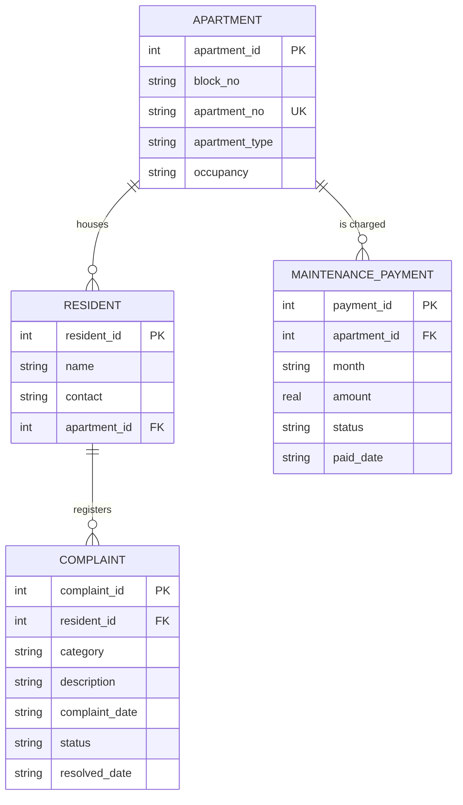

# Database Design

## 1. ER diagram


**Entities and relationships**
- One **APARTMENT** has many **RESIDENT**s (1 : N).
- One **APARTMENT** has many monthly **MAINTENANCE_PAYMENT** records (1 : N).
- One **RESIDENT** registers many **COMPLAINT**s (1 : N).

## 2. Relational model
(PK = primary key, FK = foreign key, UK = unique)

```
APARTMENT (apartment_id PK, block_no, apartment_no UK, apartment_type, occupancy)
RESIDENT (resident_id PK, name, contact, apartment_id FK -> APARTMENT)
MAINTENANCE_PAYMENT (payment_id PK, apartment_id FK -> APARTMENT, month, amount, status, paid_date,
                     UK (apartment_id, month))
COMPLAINT (complaint_id PK, resident_id FK -> RESIDENT, category, description,
           complaint_date, status, resolved_date)
```

Constraints: `apartment_type` in (1BHK, 2BHK, 3BHK); `occupancy` in (Occupied, Vacant); `status` of payment in (Paid, Pending); `category` in (Water, Electrical, Cleanliness, Other); complaint `status` in (Open, In Progress, Resolved); `amount > 0`.

The full SQL is in `sql/schema.sql`.

## 3. Normalization

### Starting point (unnormalized)
Imagine the association's paper register as one big table:

`Resident_ID, Name, Contact, Apt_No, Block, Apt_Type, Occupancy, Month, Amount, Pay_Status, Complaint_ID, Category, Description, Complaint_Date, Complaint_Status`

Problems: apartment details repeat for every payment and complaint (**update anomaly**), a vacant apartment with no resident cannot be stored (**insertion anomaly**), deleting the last complaint loses the resident's details (**deletion anomaly**), and one row mixes payments and complaints (repeating groups).

### 1NF: atomic values, no repeating groups
- Every column holds one value (a single contact number, a single month).
- Payments and complaints are separate repeating groups, so they are moved into their own rows/tables.
- Each table has a primary key.

### 2NF: no partial dependency on part of a composite key
- In the payment data the key is (apartment, month). Block, type and occupancy depend only on the apartment, not on the month, so they are moved to **APARTMENT**.
- Resident name and contact depend only on the resident, so they are moved to **RESIDENT**.
- Using single-column surrogate keys (`payment_id`, `complaint_id`) with a UNIQUE (apartment_id, month) rule removes remaining partial dependencies.

### 3NF: no transitive dependency
- `complaint_id -> resident_id -> name, contact` is transitive, so name and contact stay in **RESIDENT** and COMPLAINT keeps only `resident_id`.
- `payment_id -> apartment_id -> block_no, apartment_type` is transitive, so these stay in **APARTMENT**.
- In every table, each non-key column depends on the key, the whole key, and nothing but the key.

### BCNF check
In each of the four tables, every determinant is a candidate key (`apartment_id` / `apartment_no`, `resident_id`, `payment_id` / (`apartment_id`, `month`), `complaint_id`), so the design is in **BCNF**.

### Result
| Table | Normal form |
|---|---|
| APARTMENT | BCNF |
| RESIDENT | BCNF |
| MAINTENANCE_PAYMENT | BCNF |
| COMPLAINT | BCNF |

## 4. SQL queries
Eight report queries (pending payments, pending per apartment, monthly collection, category-wise complaints, status summary, average resolution time, complaints per block, unresolved complaints) are in `sql/queries.sql`.
